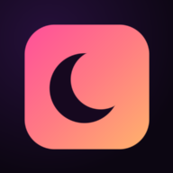
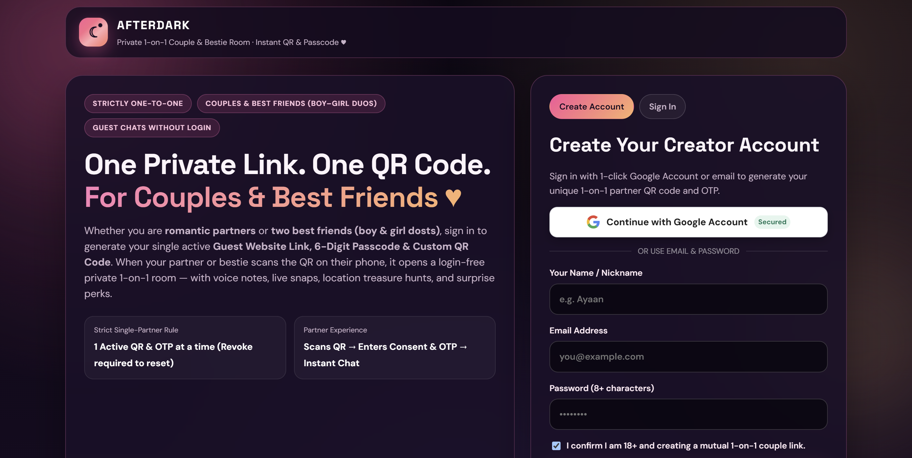
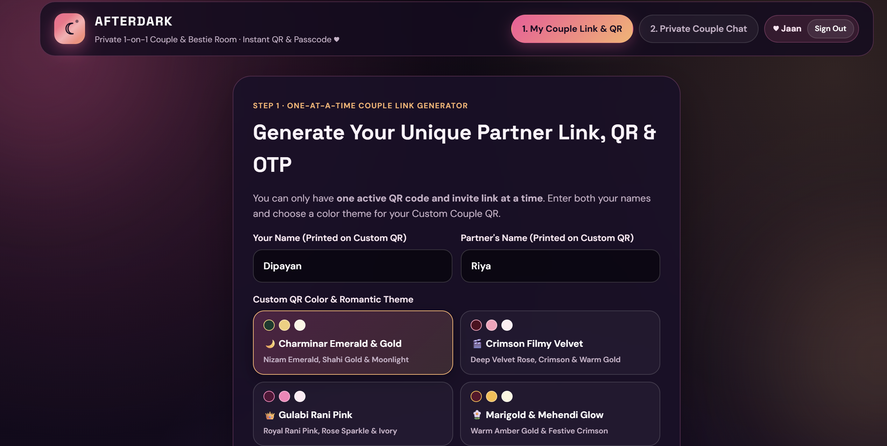
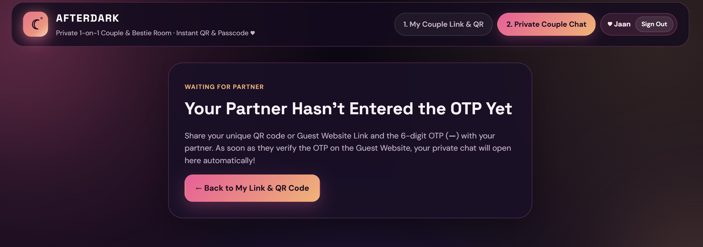
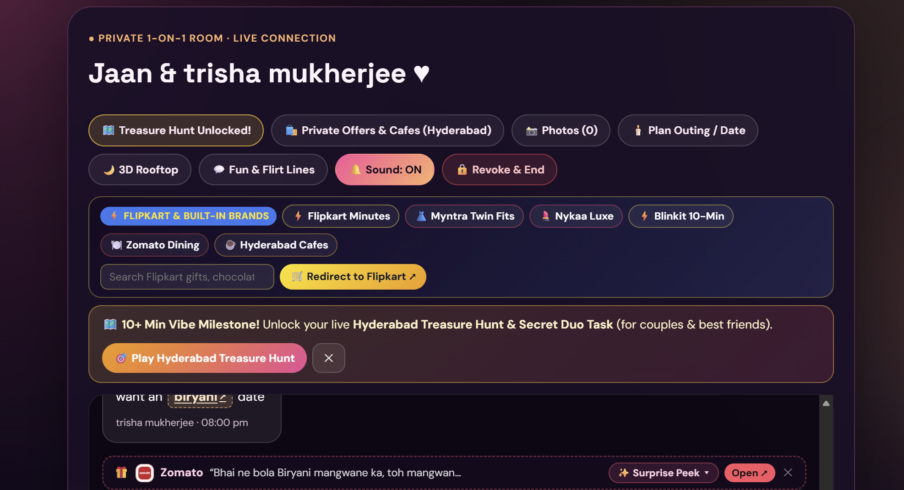
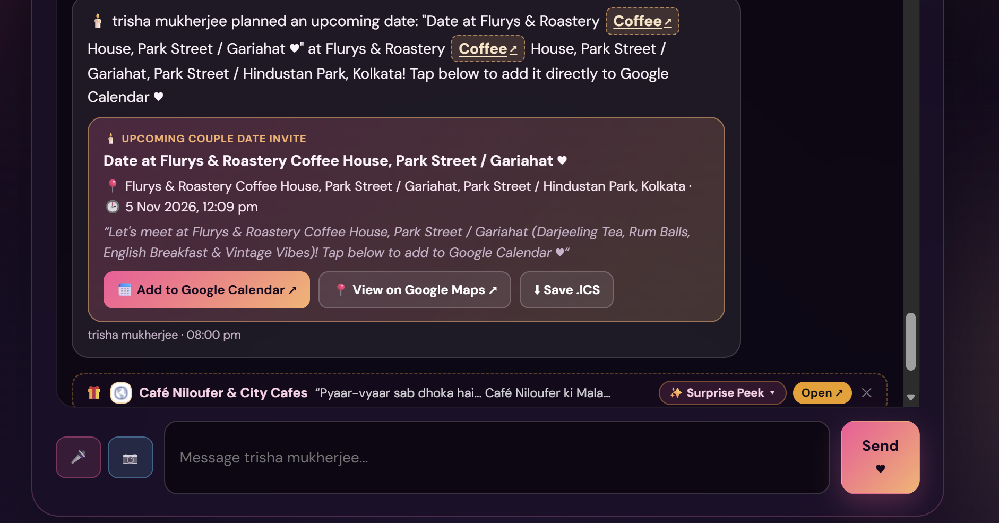
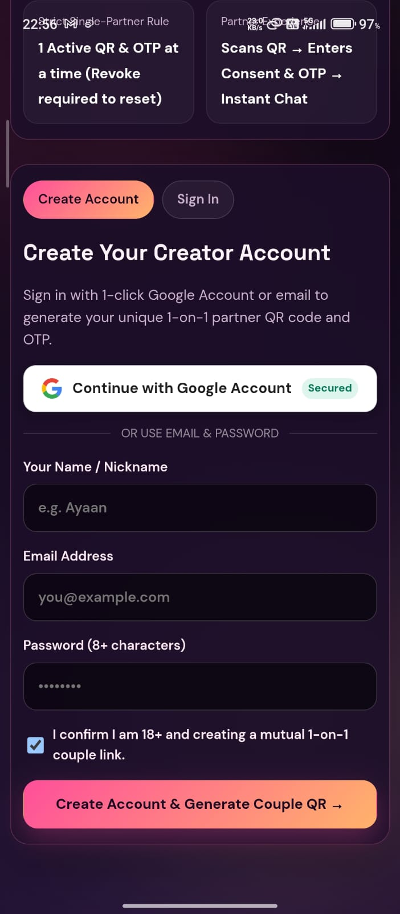
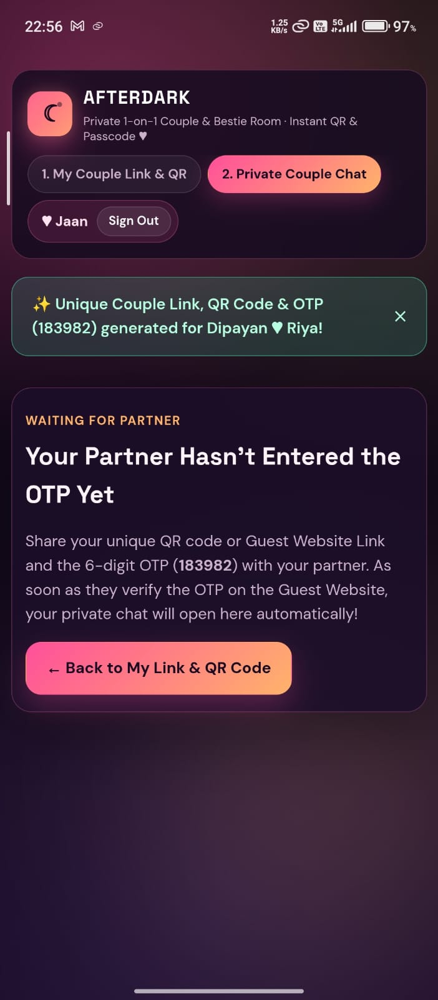

<div align="center">



# AFTERDARK 🌙

**Consent-First 1-on-1 Private Sanctuary for Couples & Best Friends (18+)**  
*Instant Custom QR Pairing · 6-Digit Passcode Lock · AES-256-GCM E2EE Chat · 100 Curated Indian Brands · Live Date Planner & Treasure Hunts*

[](https://afterdark-social-universe.vercel.app)
[](https://afterdark-social-universe.vercel.app/guest)
[](https://github.com/Dipayanhaldar/AFTERDARK/releases/latest/download/AFTERDARK-uptodown-universal.apk)
[](https://github.com/Dipayanhaldar/AFTERDARK/releases/latest/download/afterdark.apk)
[](https://github.com/Dipayanhaldar/AFTERDARK/releases/latest)

<br />


-3ddc84)


</div>

---

## 🚀 Quick Access & Official Links

| Channel | Direct Link | Description |
| :--- | :--- | :--- |
| 🌐 **Official Web App (Host)** | [**Launch AFTERDARK Web ↗**](https://afterdark-social-universe.vercel.app) | Create your account, generate your single active Couple QR & 6-digit OTP, and manage your 1-on-1 room. |
| 🔑 **Partner / Guest Portal** | [**Open Guest Portal ↗**](https://afterdark-social-universe.vercel.app/guest) | Login-free partner entry via QR scan or 6-digit OTP verification. |
| 🟢 **Uptodown Universal APK** | [**Download `AFTERDARK-uptodown-universal.apk` ↗**](https://github.com/Dipayanhaldar/AFTERDARK/releases/latest/download/AFTERDARK-uptodown-universal.apk) | Universal Android APK (`com.afterdark.universe`) for all CPU architectures (ARM64, ARMv7, x86_64) — Play-Services-free & Uptodown Monetization compliant. |
| 📲 **Direct GitHub Release APK** | [**Download `afterdark.apk` ↗**](https://github.com/Dipayanhaldar/AFTERDARK/releases/latest/download/afterdark.apk) | Latest auto-built signed Android APK from GitHub Actions CI/CD. |
| 🛡️ **Privacy Policy** | [**View Privacy Policy ↗**](https://afterdark-social-universe.vercel.app/privacy-policy.html) | 18+ consent rules, zero cross-room data leakage, and data retention policy. |

---

## 📸 Product Walkthrough & Screenshots (In Sequence)

### 1. Creator Onboarding & 1-Click Google Account Sign-In
Sign in with 1-click Google Account or email/password to create your private 1-on-1 sanctuary. Strictly one active invite link & QR code at a time.



---

### 2. Generate Your Unique Partner Link, Custom Romantic QR & 6-Digit OTP
Enter both partner names and choose a signature romantic QR theme (*Charminar Emerald & Gold*, *Crimson Filmy Velvet*, *Gulabi Rani Pink*, or *Marigold & Mehendi Glow*).



---

### 3. Single-Partner OTP Verification Gate
Your private room stays cryptographically locked until your partner scans the QR code or opens the Guest Website Link and verifies the 6-digit OTP.



---

### 4. Unlocked 1-on-1 Live Connection, 100 Built-In Indian Brands & Treasure Hunt
Once verified, the room unlocks real-time AES-256-GCM E2EE chat, contextual Indian brand suggestions (*Flipkart Minutes, Myntra Twin Fits, Nykaa Luxe, Blinkit 10-Min, Zomato Dining, City Cafes*), and the **10+ Min Vibe Milestone Treasure Hunt**.



---

### 5. Shared Couple Date Planner, Google Calendar Sync & Surprise Peek Offers
Plan upcoming dates together with 1-click **Add to Google Calendar**, **View on Google Maps**, and **.ICS download**, alongside voice notes, photo snaps, and non-intrusive Surprise Peek cafe perks.



---

### 6. Mobile & Native Android APK Experience
Optimized with camera-notch safe-area protection, responsive touch controls, and dedicated native APK notification chimes.

| **Mobile Creator Onboarding & Google Sign-In** | **Mobile Instant OTP Generation & Waiting Room** |
| :---: | :---: |
|  |  |

---

## 🔒 Product Principles & Security Architecture

- **Adults 18+ Only**: Registration and Guest room entry require explicit 18+ age and mutual consent confirmation.
- **Strict 1-on-1 Isolation (Zero Chat Merge)**: Every room is bound to a unique cryptographic connection ID, salted OTP commitment (`sha256Hex`), and a **Single-Guest Device Lock**. No two chats can ever merge or cross-read messages under any circumstance.
- **End-to-End Encryption (`AD_E2EE_V1`)**: Messages support AES-256-GCM authenticated encryption derived via PBKDF2-HMAC-SHA256 from the shared 6-digit OTP and optional custom passphrase.
- **Flirty Human Surge Bot Shield**: Token-bucket traffic control and an interactive human verification challenge protect backend routes during sudden traffic spikes without exposing ugly CAPTCHAs during normal use.
- **Contextual Brand Discovery**: Uses a local, privacy-preserving contextual ruleset across 100 curated Indian brands. Zero private chat content is ever shared with third-party advertisers.
- **Zero Secret Exposure**: Database credentials, session secrets, and signing passwords are never committed to source control.

---

## 📦 Multi-Store Android APK & Auto-Update Distribution

Every push to `main` (or tag `v*`) triggers `.github/workflows/android-apk.yml`, which compiles, signs (V1 + V2 + V3 RSA-2048), and publishes a new semantic release to **GitHub Releases**.

| Store / Platform | Package ID | Artifact to Use | Auto-Sync / Update Mechanism |
| :--- | :--- | :--- | :--- |
| **🟢 Uptodown Android Store** | `com.afterdark.universe` | `AFTERDARK-uptodown-universal.apk` | **100% Automated**: Uptodown tracks `/releases/latest` and `public/uptodown-manifest.json` (`versionCode 202608 + run_number`). Every GitHub push auto-publishes a higher `versionCode` for hands-free Uptodown refresh. |
| **🟣 PhonePe Indus Appstore** | `com.afterdark.universe` (or `com.afterdark.indus`) | `com.afterdark.universe.aab` + `afterdark-upload.jks` | Includes Phone App-only Zero-Commission PhonePe/UPI Intent Gateway + 100% Free Coupon Bypass & matching `.jks` keystore in the release bundle. |
| **🪟 Microsoft Store (Windows 10/11)** | `com.afterdark.universe` | Hosted PWA (`manifest.webmanifest`) | Auto-updates live from the production web deployment via PWABuilder. |
| **📲 Direct GitHub APK** | `com.afterdark.universe` | `afterdark.apk` | Permanent `/releases/latest/download/afterdark.apk` link always serves the newest build. |

> 📖 **Full Step-by-Step Store Submission, Keystore & Uptodown Auto-Sync Guide:** See [`docs/PRODUCTION_PUBLISHING_KEYSTORE_GUIDE.md`](docs/PRODUCTION_PUBLISHING_KEYSTORE_GUIDE.md).

---

## ⚙️ Runtime Configuration & Local Development

### Environment Variables (Serverless / Backend)
Configure these in your deployment provider (never commit secrets to the repository; see `.env.example`):

- `MONGODB_URI` — MongoDB Atlas connection string for the AFTERDARK database.
- `MONGODB_DB` — Database name (e.g., `afterdark`).
- `JWT_SECRET` — Long random secret used to sign HTTP-only session cookies and hash invite tokens.
- `RESEND_API_KEY` — API key for transactional password-reset emails via Resend.
- `FROM_EMAIL` — Verified sender address (e.g., `AFTERDARK <login@your-verified-domain>`).
- `APP_URL` — Canonical public URL (e.g., `https://afterdark-social-universe.vercel.app`).

### Local Development Commands

```bash
npm install
npm run dev          # Starts Express + Vite server on http://localhost:3000
npm run build        # Builds production web bundle into dist/
npm test             # Runs all 16 E2EE, version manifest, and room-isolation unit tests
node scripts/configure-android-apk.mjs  # Generates dot-free PNG icons, Android resources & uptodown-manifest.json
```

---

## 🧭 Developer Version Manifest & Release Sequence

> **Note:** Version numbers and update-location metadata are maintained in GitHub (`README.md`, `package.json`, `src/version-manifest.js`, `public/uptodown-manifest.json`) for developer tracking and automated store crawlers, and remain hidden from the user-facing web UI.

### Current Version: `2.0.2.8` (`versionCode: 202608 + run_number`)
**Format:** `MAJOR_GEN . STORE_CHANNEL . FEATURE_MILESTONE . UPDATE_PATCH_LOC`

| Segment | Value | Meaning | Update Locations |
| :--- | :--- | :--- | :--- |
| **1. `MAJOR_GEN`** | `2` | Generation 2 Dual-Site Host + Guest 1-on-1 E2EE Architecture | `src/main.jsx`, `src/GuestApp.jsx`, `src/couple-sync.js` |
| **2. `STORE_CHANNEL`** | `0` | Universal Cross-Device & Store Channel (Web, PWA, Uptodown Android Store, PhonePe Indus Appstore, Microsoft Store PWA) | `manifest.webmanifest`, `capacitor.config.json`, `scripts/configure-android-apk.mjs`, `public/uptodown-manifest.json` |
| **3. `FEATURE_MILESTONE`** | `2` | 100 Top Indian Brands In-Chat Catalog + Google Account Auth + Adaptive Surge Traffic Control | `src/indian-brands-100.js`, `src/google-auth.js`, `src/traffic-control.js` |
| **4. `UPDATE_PATCH_LOC`** | `8` | Uptodown Universal APK Auto-Sync & Monetization Compliance + PhonePe Indus `.jks` Keystore Bundle + Developer README Showcase | `.github/workflows/android-apk.yml`, `scripts/configure-android-apk.mjs`, `README.md`, `docs/PRODUCTION_PUBLISHING_KEYSTORE_GUIDE.md` |

### Complete Sequential Release History

| Version | Date | `versionCode` | Release Summary |
| :--- | :--- | :--- | :--- |
| **`v2.0.2.8`** *(Current)* | `2026-11-09` | `202608+` | **Uptodown Auto-Sync & Monetization Release**: Added `AFTERDARK-uptodown-universal.apk`, `public/uptodown-manifest.json`, automatic GitHub push-to-release CI trigger for hands-free Uptodown version refresh, Uptodown monetization metadata, and updated README with live buttons & sequential screenshots. |
| **`v2.0.2.7`** | `2026-11-09` | `202600+` | **PhonePe Indus Appstore Resolution & Persistent `.jks` Bundle**: Added Phone App-only (`isAndroidApkRuntime()`) Zero-Commission PhonePe/UPI Intent Gateway & 100% Free Coupon Bypass (keeping Web untouched), persistent `afterdark-upload.jks` signing across runs, and dot-free crescent moon launcher icons. |
| **`v2.0.2.6`** | `2026-11-08` | `202600` | **Hardened Security & Surge Bot Shield**: Added Flirty Human Surge Bot Quiz, Single-Guest cryptographic room lock, anti-chat-merge verification suite, and isolated temp DB storage. |
| **`v2.0.2.3`** | `2026-11-05` | `202503` | **100 Indian Brands & Native APK Audio**: Integrated 100 Top Indian Brands catalog, 1-click Google Sign-In, Adaptive Traffic Control, and Android APK Crystal Santoor notification chime. |
| **`v2.0.1.2`** | `2026-11-05` | `202502` | **E2EE Plaintext Unlock & Notch Safe-Area**: Fixed `AD_E2EE_V1` host-side decryption and added mobile camera-notch safe-area padding. |
| **`v2.0.0.1`** | `2026-11-04` | `202501` | **Gen-2 Foundation**: Initial Dual-Site Host + Guest pairing with 6-digit OTP and custom QR code themes. |


